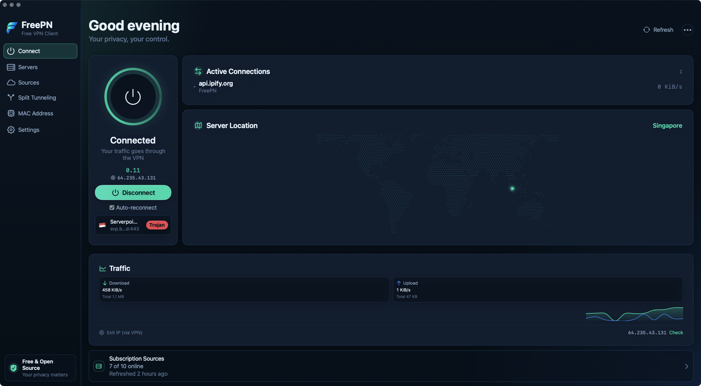
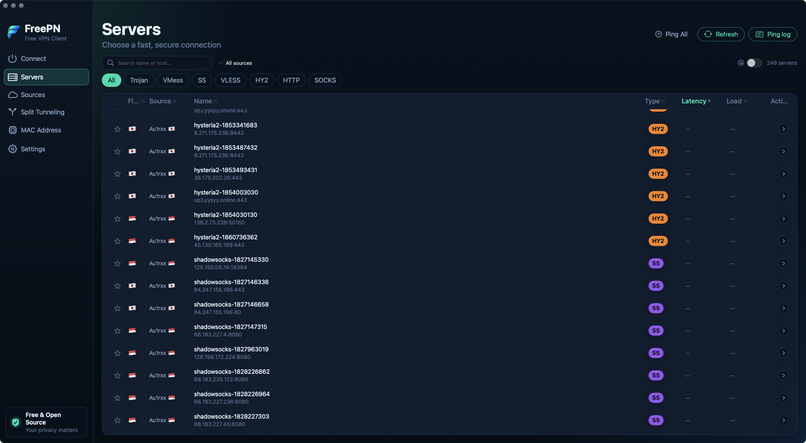
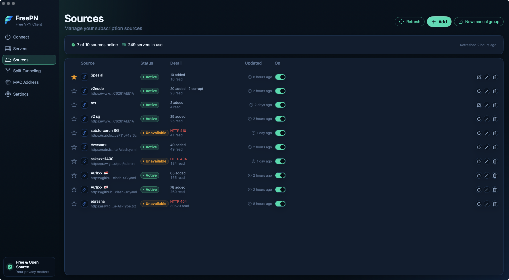
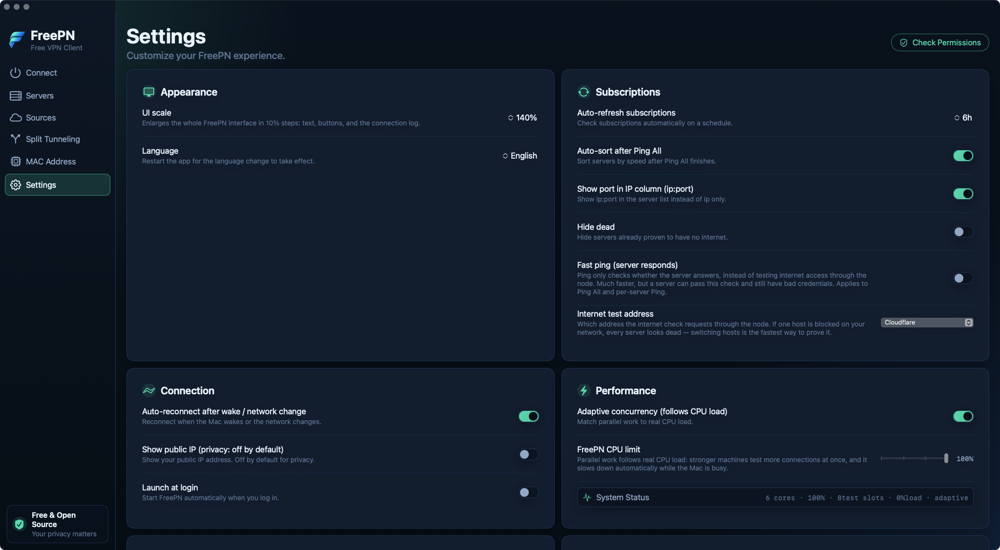

<div align="center">


# FreePN

**A free, open-source VPN client for macOS.**

Collects free public VPN subscriptions into one server list, verifies which nodes actually work, and routes your traffic through them with a bundled sing-box core — TUN mode, per-app and per-domain split tunneling, and MAC address spoofing. No accounts. No ads. No telemetry.

[English](README.md) &nbsp;·&nbsp; [Bahasa Indonesia](README.id.md) &nbsp;·&nbsp; [Website](https://freepn.pages.dev)


<a href="https://github.com/YandiDesign/FreePN/releases/latest"></a>
<a href="https://freepn.pages.dev"></a>

</div>

## Screenshots

<table>
  <tr>
    <td width="50%" align="center"><br><sub><b>Connect</b> — power ring, live connections, server map, traffic graph, exit IP</sub></td>
    <td width="50%" align="center"><br><sub><b>Servers</b> — search, protocol filters, latency, sortable columns</sub></td>
  </tr>
  <tr>
    <td width="50%" align="center"><br><sub><b>Sources</b> — subscription status, per-source counts, online/offline detail</sub></td>
    <td width="50%" align="center"><br><sub><b>Split Tunneling</b> — inclusive/exclusive, per-app and per-domain rules, change log</sub></td>
  </tr>
  <tr>
    <td width="50%" align="center"><br><sub><b>MAC Address</b> — randomize, set custom, restore, full history</sub></td>
    <td width="50%" align="center"><br><sub><b>Settings</b> — appearance, subscriptions, connection, performance</sub></td>
  </tr>
</table>

## Why "Free"?

FreePN is free in both senses:

- **No cost** — no accounts, no subscriptions, no payments, no ads, no analytics. MIT-licensed and open source.
- **Freedom** — fork it, modify it, redistribute it (attribution required, see [License](#license)).

It does **not** run or sell its own VPN servers. Instead it aggregates **free public subscription feeds** maintained by the community, lets you pick which ones to trust, and tests which nodes actually work before you connect.

## Features

### Connection

- Connect / disconnect through a bundled **sing-box** core in **TUN mode** — system-wide capture, no system proxy hijacking
- Power-ring status UI with pulse animation and session timer
- **Quick Connect** — one click to the best-known node
- **Auto-reconnect** after sleep/wake and network changes
- **Honest status** — the tunnel is verified (process alive, Clash API responding, exit IP checked through the core) before the app ever says *Connected*; a dead node is reported as an error, not a fake success

### Servers

- Aggregates **thousands of nodes** from community-maintained free sources
- Protocols: **Trojan, VMess, Shadowsocks, VLESS (REALITY/uTLS), Hysteria2**, plus HTTP and SOCKS5
- Search, filter by protocol and source, sortable columns, favorites, per-node actions
- **Ping** — optional fast TCP check, or the default full end-to-end probe through the real outbound; *Ping All* runs with adaptive CPU pacing, a time budget, progress and cancel
- Dead nodes are marked after real failures, not guesses; duplicates across sources are de-duplicated

### Sources

- Clash YAML, Base64 blobs, and raw share links are **auto-detected per source** — no per-source configuration
- Fresh install starts with **zero sources**: pick from 10 curated community feeds offered as one-click chips, or add any custom subscription URL
- **Dated-URL resolver** for feeds that rotate their links daily (tries today and up to 7 days back)
- Per-source status: nodes read / added / corrupt, HTTP errors, enable/disable, refresh one or all; manual (⌘R) and scheduled refresh

### Split Tunneling

- **Inclusive** mode (only selected apps go through the VPN) and **Exclusive** mode (everything except selected apps)
- Per-app rules matched by bundle path (also catches helper processes) and **per-domain** rules
- Application scanner, running-apps picker, and manual binary picker
- **Change log** records every rule write: what was written, when, and when it takes effect

### MAC Address

- List network interfaces, **randomize** to a valid locally-administered address, set a **custom** MAC, or restore the original
- Optional randomize-on-connect / restore-on-disconnect
- History with search and filtering

### Extras

- **Server Location map** — dotted world map rendered fully **offline** from a bundled GeoIP table
- **Traffic** — real-time up/down graph, session totals, live connection list (via the sing-box Clash API)
- **Menu bar extra** — status, connect, quick connect, ping all, quit
- **Health check panel** — helper version, core presence, ports, and one-click fixes
- App UI available in **English and Bahasa Indonesia** (switchable live)
- Accessibility: Reduce Transparency / Reduce Motion honored, VoiceOver labels

## How it works

```
┌──────────────────────┐      XPC (code-sign verified)      ┌────────────────────────────┐
│  FreePN.app (SwiftUI)│ ◄────────────────────────────────► │  FreePNHelper (root)       │
│  UI · state          │                                    │  runs the core · MAC spoof │
│  parsers · config    │                                    │  route/DNS cleanup         │
└──────────────────────┘                                    └─────────────┬──────────────┘
                                                                          │ spawns
                                                          ┌───────────────▼──────────────┐
                                                          │  sing-box (universal binary) │
                                                          │  TUN + per-process routing   │
                                                          └──────────────────────────────┘
```

- **UI** — SwiftUI app (macOS 13+ APIs), universal binary, state persisted as JSON in `~/Library/Application Support/FreePN/`
- **Core** — [sing-box](https://github.com/SagerNet/sing-box) 1.13.6 (GPL-3.0), bundled as a universal binary and wrapped behind a `VPNCore` protocol so it can be swapped
- **Privileged helper** — a small root launchd daemon (`com.freepn.helper`) that runs the core and applies MAC changes. It accepts **only an allow-list of XPC commands** (start/stop core, status, get/set/restore MAC) from a code-signature-verified FreePN — never arbitrary shell
- **Config safety** — every generated config is validated with `sing-box check` before connecting; DNS is split-aware (proxied DoH for tunneled traffic, system DNS for direct) to avoid leaks
- **No App Sandbox, not on the Mac App Store** (a privileged helper is incompatible with sandboxing) — distributed as a DMG

## Read this before using free nodes

> [!WARNING]
> - FreePN does **not** operate any VPN servers. It aggregates free public subscription feeds maintained by third parties, of unknown and varying trustworthiness.
> - **Never log in to sensitive accounts** (banking, primary email) while routed through free nodes.
> - FreePN is **not an anonymity tool**. No free node should be trusted for privacy-critical work.
> - A free node can see unencrypted traffic passing through it and may be operated by anyone. Treat it like public Wi-Fi you do not control, but faster to switch.
> - Free feeds rotate and disappear often. If nodes stop working, refresh your sources — that is normal.
> - The public IP check (api.ipify.org) is **off by default**; nothing is sent anywhere unless you ask for it.

## Download

Grab the latest DMG from **[Releases](https://github.com/YandiDesign/FreePN/releases/latest)**, or visit the website at **[freepn.pages.dev](https://freepn.pages.dev)**.

**Requirements:** macOS 13 Ventura or newer · Apple Silicon or Intel (universal binary)

> [!IMPORTANT]
> The DMG is signed with an Apple Development certificate, **not notarized**, so Gatekeeper will warn on first launch. Right-click the app → **Open**, or clear the quarantine flag:
> ```bash
> xattr -dr com.apple.quarantine /Applications/FreePN.app
> ```

### First run

1. Drag **FreePN.app** to `/Applications` (the DMG has the usual symlink)
2. Launch it — onboarding explains the privileged helper and why it is needed
3. **Install the helper** with the one-click admin prompt (or `sudo ./scripts/install-helper.sh` when building from source)
4. Go to **Sources** → pick curated feeds (or add your own) → **Refresh**
5. Go to **Servers** → **Ping All** → connect to the best node

## Build from source

**Prerequisites:** macOS 13+, Xcode 14.3 or newer. No Homebrew required.

```bash
git clone https://github.com/YandiDesign/FreePN.git
cd FreePN

# 1. Fetch the VPN core: downloads official sing-box releases for both
#    architectures and lipo's them into FreePN/Resources/sing-box
./scripts/build-core.sh          # defaults to v1.13.6, override with SINGBOX_VERSION=vX.Y.Z

# 2a. Build and launch (Debug, universal)
./scripts/run-local.sh

# 2b. Or build a Release DMG into dist/
./scripts/make-dmg.sh
```

**Install the privileged helper** (required for TUN mode):

- From the app: onboarding / Settings offers a one-click install with a single admin prompt, or
- Manually:

```bash
xcodebuild -project FreePN.xcodeproj -target FreePNHelper -configuration Release \
  -destination 'platform=macOS' ONLY_ACTIVE_ARCH=NO ARCHS='arm64 x86_64' build

sudo ./scripts/install-helper.sh              # install / re-install
sudo ./scripts/install-helper.sh --uninstall   # remove
```

> [!NOTE]
> Re-install the helper after the helper binary changes. If Connect reports "helper unavailable", install it again or check `launchctl print system/com.freepn.helper`.

**Run the tests** (574 unit tests / 35 files: parsers, config builder, real `sing-box check` validation, split-tunnel decisions, ping honesty, localization parity, helper security):

```bash
xcodebuild -project FreePN.xcodeproj -scheme FreePN -destination 'platform=macOS' test
```

**Signing note:** the project is configured for team `4DQ23N8GY5`. With no entitlements (App Sandbox off), a free Personal Team works too — set your own team in *Signing & Capabilities* if needed.

**Regenerate the offline GeoIP table** (optional — needs a MaxMind `GeoLite2-City.mmdb` and `pip install maxminddb`):

```bash
python3 scripts/build-geolite2.py path/to/GeoLite2-City.mmdb
```

## Project structure

```
FreePN/                   App source
  App/                    entry point, central state, menu bar extra
  Core/
    Models/               ProxyNode, Source, PingResult
    Parsing/              Clash YAML · share links · auto-detect · dedup
    Persistence/          JSON store, settings
    Ping/                 TCP + end-to-end probes, CPU governor
    Subscription/         fetching, dated-URL resolver
    VPN/                  config builder, connection manager, helper install, health
  DesignSystem/           theme, cards, badges
  Localization/           en + id Localizable.strings
  UI/                     Connect · Servers · Sources · Split Tunneling · MAC · Settings
  Resources/              Info.plist, assets, GeoIP table, sing-box (fetched)
  Vendor/DotMap/          vendored MIT dotted-map renderer
FreePNHelper/             root XPC daemon (runs the core, MAC spoofing)
Shared/                   XPC protocol, split-tunnel logic, validators
FreePNTests/              35 test files / 574 tests
scripts/                  build-core · run-local · install-helper · make-dmg · notarize · geoip
DECISIONS.md              engineering log — 98 documented decisions
LICENSES/                 third-party licenses and attributions
```

## Troubleshooting

| Symptom | Where to look |
|---|---|
| "Helper unavailable" / Connect fails | `launchctl print system/com.freepn.helper`, then re-install: `sudo ./scripts/install-helper.sh` |
| Core fails to start | `/var/log/freepn-core-stderr.log` (tail is also visible in the app's Health panel) |
| Helper log | `/var/log/freepn-helper.log` |
| VPN decisions | `log show --predicate 'subsystem == "com.freepn.app"' --last 10m` |
| All nodes turn "dead" after refresh | Free feeds rotate daily — refresh sources; if your network blocks the default test host, change it in Settings → Internet test address |
| A node pings fine but has no internet | That is what the default end-to-end ping is for — fast TCP ping only proves the server answers |
| MAC change fails | MAC spoofing briefly disconnects networking and is not supported on every macOS release/interface; the app verifies the write and reports honestly |

## Localization

The app ships in **English** and **Bahasa Indonesia** (`FreePN/Localization/{en,id}.lproj`); `scripts/check-localization.sh` enforces identical key sets. This documentation is bilingual too:

- [English](README.md) (this file)
- [Bahasa Indonesia](README.id.md)

## License

[MIT](LICENSE) © 2026 YandiDesign — free to use, fork, and redistribute, **with attribution**: keep the copyright notice and the in-app About credits. The [LICENSE](LICENSE) file contains the full attribution requirement.

Third-party components:

| Component | License |
|---|---|
| [sing-box](https://github.com/SagerNet/sing-box) (bundled core) | GPL-3.0 |
| [DotMap](https://github.com/spilneo/DotMap) (vendored map renderer) | MIT |
| GeoLite2 City data (MaxMind) | GeoLite2 EULA |
| GeoNames data | CC BY 4.0 |

Full details in [LICENSES/THIRD-PARTY.txt](LICENSES/THIRD-PARTY.txt) and the in-app About screen.

---

<div align="center">
<sub>Made by <a href="https://github.com/YandiDesign">YandiDesign</a> · If FreePN is useful to you, a star helps.</sub>
</div>
